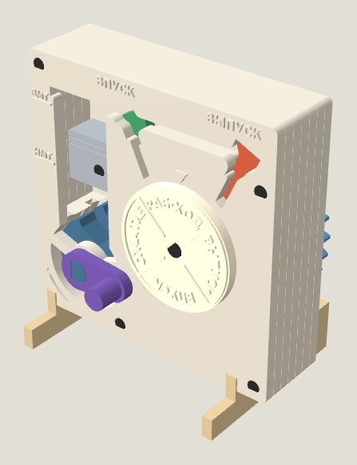

# design-sprue-kit

An AI agent skill that turns a model description and your printer model into a **3D-printable kit on a sprue** and a **step-by-step assembly guide**.



The agent sets design rules for your printer, plans the parts and build order, and builds the model in code. It then assembles the kit itself to check that every step works, and only after that lays out the sprue and writes the guide.

## Usage

```
Design a sprue kit of a working steam locomotive drive.
Printer: Prusa MK4.
```

The agent needs to be able to run code and write files. To print the result, you need a slicer for your printer.

## Install

The skill is one file in the open [Agent Skills](https://agentskills.io) format: [`SKILL.md`](plugins/design-sprue-kit/skills/design-sprue-kit/SKILL.md).

- **Agents that support skills**: copy the `plugins/design-sprue-kit/skills/design-sprue-kit/` folder into the agent's skills directory, for example `~/.claude/skills/` for Claude Code.
- **Claude Code plugin**:
  ```bash
  claude plugin marketplace add d521bb85/design-sprue-kit
  claude plugin install design-sprue-kit@design-sprue-kit
  ```
- **Any other assistant**: paste the contents of `SKILL.md` into its instructions or system prompt.

## Example

[`examples/four-stroke-engine/`](examples/four-stroke-engine/) contains a single-cylinder engine kit for Bambu Lab P1S. It has the sprue STL, the assembly guide (in Russian), and an assembly animation.

## License

MIT
