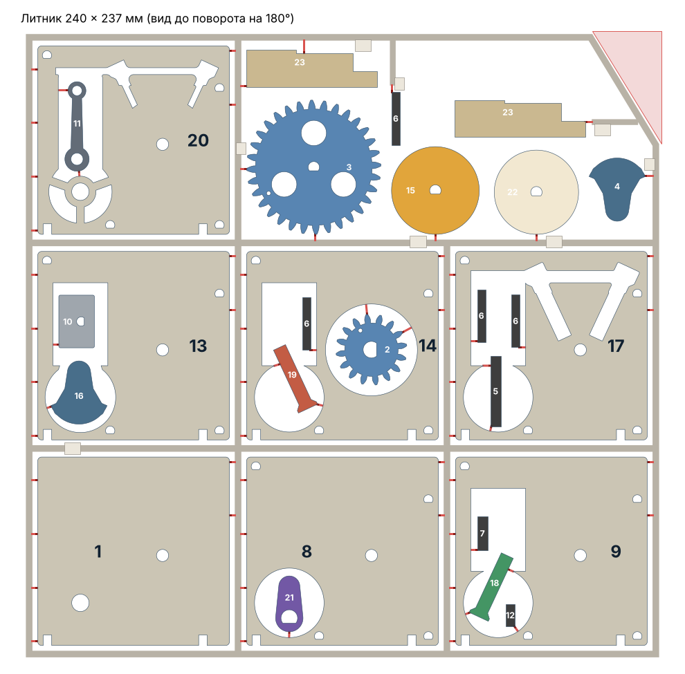

# design-sprue-kit

A Claude skill that turns a model description and your printer model into a **3D-printable kit on a sprue**. You get parts that snap out of a frame, like a plastic model kit, plus a **step-by-step assembly guide** in the style of a retail kit manual.


## What it does

You describe what you want and name your printer, for example: *"a working cutaway of a single-cylinder four-stroke engine, Bambu Lab P1S"*. Claude then:

1. Looks up your printer's bed size, nozzle and any no-go zones on the bed.
2. Designs the model as flat, support-free parts with fits tuned for FDM printing.
3. Builds the full 3D assembly and checks it in code. It tests collisions through the whole motion cycle, measures clearances and confirms the assembly order works.
4. Lays out every part on a single sprue that fits your bed. The sprue has thin snap-off gates and numbered tags.
5. Writes an assembly guide PDF, with each step rendered from the same verified 3D model.

The subject can be anything: machines, vehicles, animals, buildings, toys. Text on the parts and in the guide is written in your language.

## Requirements

- Claude with code execution: Claude Code, or the Claude app with file and code tools.
- No CAD software. The model is built in code with free Python libraries (shapely, manifold3d, matplotlib, reportlab), which Claude installs as needed.
- A slicer for your printer, for example Bambu Studio, PrusaSlicer or OrcaSlicer, to print the resulting STL.

## Install

**Claude Code plugin**

```bash
claude plugin marketplace add <owner>/design-sprue-kit
claude plugin install design-sprue-kit@design-sprue-kit
```

**As a plain skill**

Copy `plugins/design-sprue-kit/skills/design-sprue-kit/` into `~/.claude/skills/`, or upload `SKILL.md` as a custom skill in the Claude app.

## Usage

```
Design a sprue kit of a working steam locomotive drive (wheels, connecting rods, piston).
Printer: Prusa MK4.
```

If you leave out the printer, Claude asks for it.

## Example: four-stroke engine

`examples/four-stroke-engine/` holds a kit made while developing this skill:

| File | What it is |
|---|---|
| `engine-v3-p1s.stl` | Whole kit on one 240 × 237 mm sprue for Bambu Lab P1S/X1/A1 |
| `assembly-guide-ru.pdf` | 10-page assembly guide (Russian) |
| `assembly.mp4` | Animation: step-by-step assembly, then the engine running |
| `sprue-map.png`, `strokes.png` | Sprue layout and the four strokes |



## Repository layout

```
.claude-plugin/marketplace.json            marketplace manifest
plugins/design-sprue-kit/
  .claude-plugin/plugin.json               plugin manifest
  skills/design-sprue-kit/SKILL.md         the skill
examples/four-stroke-engine/               example output
```

## License

MIT
